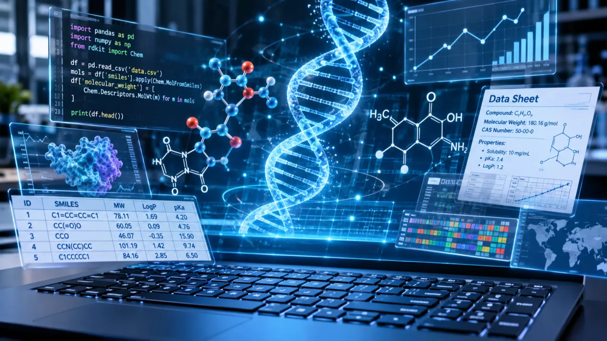

<!-- excerpt-start -->
I've just published a new article on LinkedIn about **vibe coding in cheminformatics and bioinformatics**: what happens when scientists without a programming background can describe a task in plain language and let an LLM write the code.
<!-- excerpt-end -->

Image generated using AI

In short: LLMs can now produce scripts, ML models, full pipelines and dashboards on demand, and that is great news for wet-lab chemists and biologists. But recent benchmarks show that while models handle simple tasks well, they struggle with multi-step workflows that need real chemical reasoning. Code that runs is not necessarily code that is right, and silent errors (stereochemistry, batch effects, data leakage...) are the dangerous ones.

Take home message: Vibe coding doesn't replace the scientist, the cheminformatician or the bioinformatician. It makes **collaboration between subject matter experts (SMEs) and technical people more important than ever**: experts prototype and frame the problems, and computational people review, architect and make sure the results are correct and reproducible.

👉 **[Read the original article on LinkedIn](https://www.linkedin.com/pulse/vibe-coding-wont-replace-scientist-change-who-can-sanchez-martinez-wudrf/)**

For convenience, here it is reproduced in full.

---

### Vibe coding won't replace the scientist, but it will change who can build

A few years ago, a wet-lab chemist who wanted to filter a compound library, cluster hits, or build a quick QSAR model had two options: learn to program or wait for someone who could. Today there's a third: describe what you want in plain language and let an AI write the code.

This is vibe coding. You describe the task, the LLM writes the code, and you run it and iterate it. In cheminformatics and bioinformatics the range of what it can produce is wide:

- **Scripts:** [RDKit](https://www.rdkit.org/) substructure searches, descriptor calculations, file format conversions, sequence parsing, BLAST or alignment wrappers
- **Modelling:** ML and DL models, from QSAR to omics-based classifiers, including the unglamorous but critical parts like data cleaning, curation, and validation splits
- **Workflows:** end-to-end virtual screening pipelines, RNA-seq or single-cell analysis pipelines, data processing chains, automated reporting
- **Apps:** R Shiny or Streamlit dashboards that put a model or dataset in front of colleagues who will never open a terminal

The barrier to building something useful has never been lower. That is good news, but it isn't the whole story.

### The evidence: easy is easy, hard is still hard

A recent preprint ([Li et al., 2026](https://arxiv.org/abs/2605.02351)) tested frontier LLMs on 358 molecular coding tasks across five levels of difficulty. The levels run from recalling a single API call up to designing a complete virtual screening pipeline, across 12 real drug discovery workflows.

The pattern is striking. Models do reasonably well on simple, single-step tasks, and success rates collapse as tasks become multi-step workflows that require real chemical reasoning. Much of the generated code runs, but running is not the same as being chemically correct.

That gap is the whole point. Code that executes without errors but mishandles stereochemistry, tautomers or charge states, normalises omics data incorrectly, ignores batch effects, mixes genome assemblies, or leaks data between training and test sets is more dangerous than code that crashes, because nobody notices.

### So who is needed?

The wet-lab scientist, whether chemist or biologist, brings something the LLM cannot: deep domain knowledge. They know what the question is, what a sensible answer looks like, and which result smells wrong. That knowledge is exactly what's needed to write a good prompt and give the model the right context.

But judging whether a script or workflow is correct is a different skill from judging whether a molecule is sensible. Is the descriptor computed the way you think it is? Are the right genes being called differentially expressed? Is the model overfitting? Did the pipeline silently drop 30% of your compounds at a parsing step? These questions need someone who can read and reason about code and methods.

So vibe coding is not a substitute for the scientist, the cheminformatician, or the bioinformatician. It's an assistant: fast, tireless, and sometimes overconfident. Like any assistant, it's only as good as the person able to check its work.

### The real takeaway: SMEs + tech, more than ever

If anything, vibe coding makes collaboration more important:

- **Subject matter experts** can now prototype ideas themselves, frame problems precisely, and validate outputs scientifically.
- **People with computational and technical knowledge** become the reviewers, architects, and quality gate who make sure a prototype is correct, reproducible, and ready for real decisions.

The teams that move cheminformatics, bioinformatics and computational chemistry forward won't be the ones that replace experts with AI. They'll be the ones with a mix of domain expertise and technical judgment, and who use AI to move forward faster.

LLMs are our friends and our work assistants. They lower the barrier to building. **They don't lower the bar for being right.**

How are you using vibe coding in your lab or team, and who checks the output?

### Sources

- Li, J. et al. – [MolViBench: Evaluating LLMs on Molecular Vibe Coding](https://arxiv.org/abs/2605.02351), arXiv 2605.02351 (May 2026)
- [MolViBench code repository](https://github.com/YongLD/MUG) (GitHub)
- [RDKit](https://www.rdkit.org/) – Open-source cheminformatics toolkit

***This article was written with the help of AI and was originally published on [LinkedIn](https://www.linkedin.com/pulse/vibe-coding-wont-replace-scientist-change-who-can-sanchez-martinez-wudrf/).***
