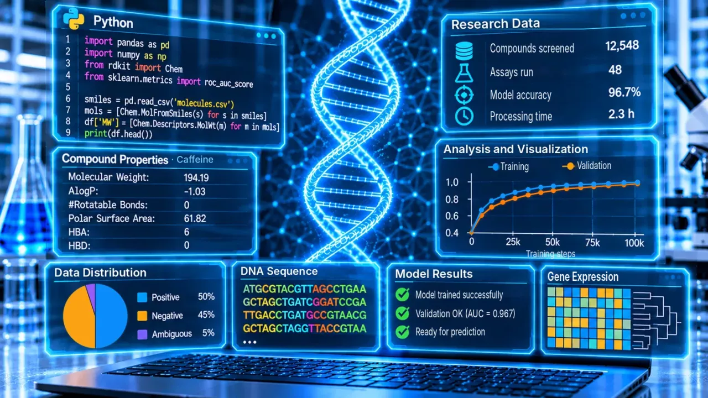

<!-- excerpt-start -->
I've just published a new article on LinkedIn about **data products in cheminformatics and bioinformatics**: why the term means everything and nothing, and how a simple distinction between *Lite* and *Full* Data Products brings clarity to what drug discovery organisations should build and invest in.
<!-- excerpt-end -->

Image generated using AI

In short: following the Zifo white paper [Redefining Data Products](https://zifornd.com/white-papers/redefining-data-products/), **Lite Data Products** are curated, standardised and documented datasets governed by a data contract (a compound registry, harmonised assay data, processed omics matrices...), while **Full Data Products** are managed solutions that turn data into measurable scientific or business value (an ADMET prediction service in the DMTA cycle, a hit triage dashboard, a virtual screening service...). **Data-as-a-Product** is the way of working that keeps both valuable and sustainable.

Take home message: AI makes building cheap, but a working prototype is not a Full Data Product. And once again, it takes **subject matter experts (SMEs) and technical people together**: experts define what "correct" and "valuable" mean, and technical people make it durable.

👉 **[Read the original article on LinkedIn](https://www.linkedin.com/pulse/data-product-means-everything-nothing-lets-fix-sanchez-martinez-g8zmf/)**

For convenience, here it is reproduced in full.

---

### "Data product" means everything and nothing. Let's fix that for cheminformatics and bioinformatics

Ask five people in a drug discovery organisation what a data product is and you will get five answers. A curated compound table. A database. An ML model. A Shiny dashboard. Everything in the data lake. This is not just semantics. When the term means everything, leaders cannot prioritise, teams build the wrong things, and money is spent without a clear link to scientific or business value.

A recent white paper from Zifo, [Redefining Data Products](https://zifornd.com/white-papers/redefining-data-products/), proposes a simple distinction that brings clarity. Here is how it applies to our field.

### Two valid meanings, two different jobs

The confusion exists because the same term is used to refer to different parts of the data value chain.

**Lite Data Products** are curated, standardised, documented datasets packaged for reuse. Their value lies in being reliable building blocks. They are governed by a data contract: an agreement on ontology, data model, metadata, quality rules, and versioning.

**Full Data Products** are managed digital solutions that turn data into measurable scientific or business value through analytics, AI, visualisation, or automation. They have a defined purpose, an owner, a lifecycle, and a clear link to an outcome. They are governed by a specification that references the underlying datasets and describes everything needed to build and operate the solution.

To use an analogy that every chemist will recognise: raw chemicals become excipients (curated components), which become an approved drug (the finished solution). Excipients are essential, but nobody is cured by an excipient alone.

### What this looks like in our world

#### Lite Data Products: the reliable components

- A compound registry with consistent structure standardisation (salts, tautomers, stereochemistry, charges) and stable identifiers
- Harmonised assay data, where every value is linked to its protocol, units, conditions, and controls
- Versioned molecular representations: descriptors, fingerprints, or embeddings tied to the exact toolkit and settings used
- Processed omics matrices with batch information and consistent ontologies

#### Full Data Products: the solutions that drive decisions

- An ADMET prediction service embedded in the design–make–test–analyze (DMTA) cycle, with a documented applicability domain and a retraining policy
- A hit triage dashboard that medicinal chemists actually use to decide what to make next
- A virtual screening workflow offered as a managed service, not a script on someone's laptop
- A biomarker discovery app that translates omics data into clinical hypotheses

Science-driven organisations, whose business is drug discovery and not selling data, should prioritise Full Data Products when investing. Curated datasets are necessary, but on their own they are, as I'd put it, *ready to use but still waiting for a purpose*.

### The mindset behind both: Data-as-a-Product

A data product is an artefact. Data-as-a-Product is the way of working that makes it valuable and sustainable. It brings product management discipline into data work through five principles:

- **Purpose and audience:** who uses it and for what decision
- **Ownership and accountability:** a named owner, not "whoever ran the script last"
- **Lifecycle management:** products evolve, get versioned, and eventually retire
- **Quality and discoverability:** people can find it and trust it
- **User-centric value creation:** built around real scientific workflows

Governance is designed in from the start, not bolted on at the end.

### Why this matters more now

With AI it has never been easier for a chemist or biologist to build a script, a pipeline, or a Shiny app in an afternoon. That is powerful. But a working prototype is not a Full Data Product. Without an owner, a specification, a lifecycle, and a clear link to a decision, it is one more orphaned artefact that others quietly come to depend on.

The industry is already acting on this. Eli Lilly's [TuneLab](https://www.biopharmatrend.com/post/1363-lilly-offers-biotechs-access-to-ai-models-trained-on-1b-in-proprietary-drug-discovery-data) gives biotechs access to models trained on data that Lilly estimates cost over $1 billion to generate, without the raw data ever leaving Lilly. That is a Full Data Product in all but name. Through the [AISB consortium](https://www.genengnews.com/topics/artificial-intelligence/secure-ai-collaboration-will-fine-tune-openfold3-with-proprietary-data/), AbbVie, J&J and others fine-tune OpenFold3 on their proprietary structures through federated learning, which only works because the underlying data is curated and governed. And as AI agents start running experiments in [autonomous labs](https://www.nature.com/articles/s41586-026-11228-6), data can be born as a product: structured, traceable and linked to its protocol from the instrument onwards.

The question to ask any AI tool, whether a [chemistry agent](https://deepmind.google/blog/agentic-cheminformatics-with-google-antigravity/) or a predictive model, is a data product question: can I trace this result back to the calculation, the record and the source, and does it keep measured data apart from predictions?

AI makes building cheap. **Data-as-a-Product thinking is what keeps the things we build trustworthy.**

### SMEs + tech, once again

Chemical and biological data only make sense through domain knowledge. The same molecule can be drawn in many ways, and an IC50 means nothing without its assay context. That is why neither profile can do this alone:

- **Subject matter experts** define what "correct" and "valuable" mean: standardisation rules, which metadata matter, which decisions the product should support.
- **Technical people** make it durable: data contracts, pipelines, APIs, versioning, and quality checks.

Lite Data Products build trust and reuse. Full Data Products deliver insight and impact. Data-as-a-Product makes sure both are managed with purpose and accountability.

In your organisation, when someone says "data product", which one do they mean?

### Sources

- Zifo – [Redefining Data Products](https://zifornd.com/white-papers/redefining-data-products/) (white paper, Mar 2026)
- BioPharmaTrend – [Lilly offers biotechs access to AI models trained on $1B in proprietary drug discovery data](https://www.biopharmatrend.com/post/1363-lilly-offers-biotechs-access-to-ai-models-trained-on-1b-in-proprietary-drug-discovery-data) (Sep 2025)
- GEN – [Secure AI collaboration will fine-tune OpenFold3 with proprietary data](https://www.genengnews.com/topics/artificial-intelligence/secure-ai-collaboration-will-fine-tune-openfold3-with-proprietary-data/) (Mar 2025)
- Wu, M. et al. – [An AI-native experimental laboratory for autonomous biomolecular operations (AutoDNA)](https://www.nature.com/articles/s41586-026-11228-6), Nature (2026)
- Google DeepMind – [Agentic cheminformatics with Google Antigravity](https://deepmind.google/blog/agentic-cheminformatics-with-google-antigravity/) (Nov 2026)

***This article was written with the help of AI and was originally published on [LinkedIn](https://www.linkedin.com/pulse/data-product-means-everything-nothing-lets-fix-sanchez-martinez-g8zmf/).***
