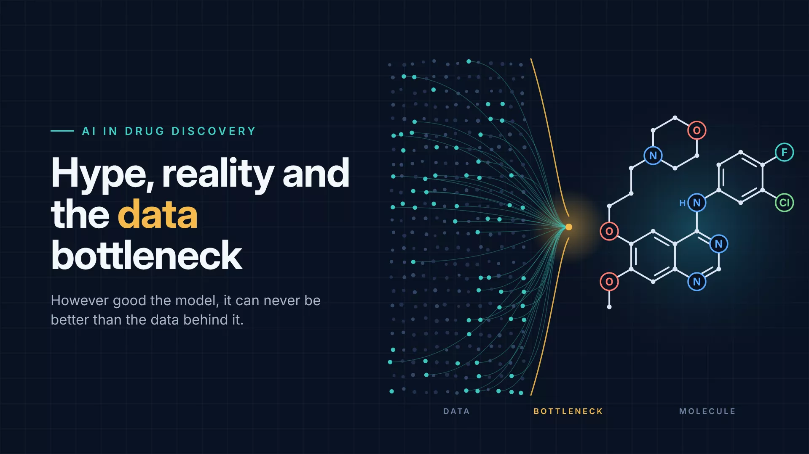

<!-- excerpt-start -->
I've just published a new article on LinkedIn about **AI in drug discovery**: what is hype, what is now backed by clinical data, why foundation-model companies are moving into biotech, and why the real bottleneck has never been the algorithm but the **data**.
<!-- excerpt-end -->

Image generated using AI

In short: the change is real. Computationally designed drugs such as **zasocitinib** and **rentosertib** have reached Phase III and FDA review, AI labs like Anthropic, OpenAI and Isomorphic Labs are moving into biotech directly, and AI agents are starting to run experiments in the wet lab. But AI-discovered molecules still fail in Phase II as often as traditional ones, because picking the right biology for the right patients is, fundamentally, a data problem.

Take home message: a model is only as good as the data behind it. The winners will be whoever controls the best **data loop**: generating high-quality experimental data, feeding it to models and testing their predictions in the lab and the clinic. And people are still needed: **scientists who frame the right questions, generate trustworthy data and judge whether a prediction makes biological sense**.

👉 **[Read the original article on LinkedIn](https://www.linkedin.com/pulse/ai-drug-discovery-hype-reality-bottleneck-nobody-talk-melchor-3h5ke/)**

For convenience, here it is reproduced in full.

---

### AI in drug discovery: hype, reality, and the bottleneck nobody wants to talk about

Every few months, AI is about to revolutionise drug discovery. Today the headlines are louder than ever, and for the first time they come with clinical data, regulatory filings and billion-dollar deals. So is this finally the moment, or another hype cycle?

My personal view: the change is real. But the limiting factor has never really been the algorithm. It has been, and still is, the data.

### 1. The real bottleneck: data

It doesn't matter how good a model is; it can only learn what its data contains. In drug discovery, the data that matters most is scarce, fragmented and mostly locked inside companies.

- The Protein Data Bank holds over 200,000 experimental structures, and protein–small-molecule complexes, the ones that matter most for drug design, are poorly represented. It seems [public data is hitting its limit](https://www.nature.com/articles/d41586-025-00868-9).
- That is why AbbVie, Johnson & Johnson and others formed the [AI Structural Biology (AISB) consortium](https://www.genengnews.com/topics/artificial-intelligence/secure-ai-collaboration-will-fine-tune-openfold3-with-proprietary-data/) to fine-tune OpenFold3 on their proprietary structures through federated learning. Hence, the data never leaves each company. The key bottleneck is data, which, fortunately, exists in large quantities in pharmaceutical repositories (2025).
- Eli Lilly launched [TuneLab](https://www.biopharmatrend.com/post/1363-lilly-offers-biotechs-access-to-ai-models-trained-on-1b-in-proprietary-drug-discovery-data), which gives biotechs access to models trained on data that Lilly estimates cost over $1 billion to generate. Partners pay in kind by contributing their own data.
- Lilly and NVIDIA are investing over $1 billion over five years in a [co-innovation lab](https://www.fiercebiotech.com/biotech/lilly-nvidia-tag-partnership-new-ai-co-innovation-lab-1b-investment) whose purpose is explicitly to generate the experimental data needed to train and validate AI models.

The signal is clear. The most valuable assets aren't the models, which are increasingly a commodity. They are high-quality, well-annotated, decision-relevant data, plus the closed loop between model and wet lab. This links back to my [previous post on data products](): no trusted data, no trusted AI.

### 2. The AI-native biotechs: claims meet the clinic

Companies like Insilico Medicine, BenevolentAI, Exscientia and Recursion have claimed AI-discovered compounds for years. The record is now long enough to judge:

- **Insilico Medicine:** rentosertib, a TNIK inhibitor for idiopathic pulmonary fibrosis where both target and molecule came from AI, showed a dose-dependent improvement in lung function in a Phase IIa trial published in Nature Medicine ([Xu et al., 2025](https://pubmed.ncbi.nlm.nih.gov/40461817/)). Phase III started in September 2026. Insilico reports moving from project start to preclinical candidate in 12–18 months, versus the typical 2.5–4 years, and raised ~$293M in a [Hong Kong IPO](https://pharmaphorum.com/news/insilico-ends-2025-293m-hong-kong-ipo) in December 2025.
- **Zasocitinib (Takeda, originally Nimbus):** a computationally designed TYK2 inhibitor that Takeda acquired for $4 billion. It [succeeded in Phase III](https://www.biospace.com/drug-development/takedas-4b-nimbus-bet-pays-off-with-best-in-class-phase-iii-plaque-psoriasis-data) psoriasis trials, and the FDA [accepted the NDA under Priority Review](https://www.takeda.com/newsroom/newsreleases/2026/fda-priority-review-zasocitinib-psoriasis/), with a decision expected in Q1 2027. This could be one of the first approvals of a drug whose discovery was heavily computational.
- **BenevolentAI:** its lead AI-identified asset for atopic dermatitis was safe but [no better than placebo](https://www.fiercebiotech.com/biotech/benevolentai-cruel-rd-ai-enabled-drug-flunks-midphase-eczema-trial-dent-deal-plans) in efficacy in Phase IIa (2023). The company [delisted from Euronext Amsterdam](https://www.businesswire.com/news/home/20250205177929/en/Proposed-Delisting-via-Merger-of-BenevolentAI-into-Osaka-Holdings-S.-r.l.-and-Publication-of-Notice-of-Extraordinary-General-Meeting) in March 2025.
- **Recursion + Exscientia:** they [merged in 2024](https://pharmaphorum.com/news/ai-biotechs-exscientia-and-recursion-agree-688m-merger) (~$688M) to combine phenomics and automated chemistry, and in 2025 they [cut several clinical programs](https://biopharmadive.com/news/recursion-pipeline-cuts-first-quarter-earnings/747119) after disappointing data and to manage cash burn.

The data so far is nuanced. A BCG analysis published in Drug Discovery Today ([Jayatunga et al., 2024](https://doi.org/10.1016/j.drudis.2024.104009)) found AI-discovered molecules reached Phase I success rates of 80–90%, versus a 40–65% historical average. In Phase II, however, they were around 40%, similar to traditional drugs. AI seems to help make better molecules, but it doesn't yet solve the hardest problem: picking the right biology for the right patients. That is, fundamentally, a data problem.

According to [industry trackers](https://intuitionlabs.ai/articles/ai-discovered-drugs-clinical-trials-2026), more than 100 AI-enabled assets have entered clinical trials, and as of mid-2026, none has received full FDA approval yet. That may be about to change.

### 3. The new phase: AI labs entering biotech directly

This is the part that feels different. Foundation-model companies are no longer only selling tools to pharma. They are moving into the work itself:

- **Anthropic** [acquired Coefficient Bio](https://thenextweb.com/news/anthropic-just-paid-400-million-for-a-startup-with-fewer-than-10-people) (April 2026, ~$400M in stock) and Mithril Medicine, a one-person rare disease company. With Mithril, it is now running its own drug program for a form of muscular dystrophy that went from idea to promising mouse data in under 18 months. In October 2026, it also [reported results](https://www.anthropic.com/research/early-progress-drug-development) with partners such as Generate Biomedicines, BigHat, Enveda and BMS. With Enveda, Claude reviewed 1,061 pages of manufacturing documentation, caught all 11 issues human reviewers found plus seven they missed, and cut review time by 89%. Anthropic is clear that this is mostly preclinical.
- **OpenAI** [acquired Orchestra Bio](https://siliconangle.com/?p=851271) (October 2026), a startup building AI agents for biotech operations, to strengthen Rosalind, its life sciences model, which counts Moderna and Novo Nordisk among its customers.
- **Google DeepMind's** spin-out Isomorphic Labs [raised $2.1 billion](https://yourstory.com/ai-story/isomorphic-labs-ai-drug-discovery-series-b-2026) in May 2026, has partnerships with Lilly and Novartis worth nearly $3 billion in potential milestones, and is targeting first-in-human trials by late 2026, later than its original end-2025 goal.

The tools themselves are also becoming products. In November 2026 Google DeepMind launched [Cheminformatics Skills for Antigravity](https://deepmind.google/blog/agentic-cheminformatics-with-google-antigravity/), its Gemini-based agent platform. The LLM orchestrates the workflow and reasons, while deterministic tools built on RDKit and connected to ChEMBL and PubChem do the chemistry. In a lung cancer demo starting from crizotinib and its macrocyclic successor lorlatinib, the agent searched papers and patents, curated 568 relevant compounds, ran matched molecular pair analysis, built and validated potency models, and proposed new macrocycles with synthesis routes. DeepMind says this took about an hour, versus several days for a typical single iteration. Two caveats: that is the company's own figure, not an independent benchmark, and none of the molecules has been made or tested yet.

DeepMind itself calls them "testable hypotheses, not finished drugs." Nor is the idea new; academic agents such as ChemCrow ([Bran et al., 2024](https://doi.org/10.1038/s42256-024-00832-8)) showed similar tool-using workflows earlier. What is new is the usability. The questions that matter now are total expert time, including review and correction, and traceability: can you follow each recommendation back to the calculation, the record and the paper, and does the tool keep measured data apart from predictions?

### 4. Closing the loop: AI enters the wet lab

Most of AI's impact in science so far has been computational: analysing data, making predictions, designing molecules. But an AI can design a promising molecule in minutes, while testing it still takes weeks or months of human effort. That gap is where data is generated, and it is the real bottleneck.

This is starting to change. A paper recently published in Nature ([Wu et al., 2026](https://www.nature.com/articles/s41586-026-11228-6)) introduces AutoDNA, an automated lab where LLM-powered agents plan and run molecular biology experiments with little human intervention. A planner agent coordinates specialist agents that search the literature, check reagents, write protocols, generate code and operate more than 20 types of instruments. In one case study, the system optimised an enzymatic DNA synthesis reaction to 97.8% yield, comparable to expert-optimised results. In another, it detected a KRAS mutation in a colorectal cancer sample and designed primers to confirm it. One run involved 11,382 instrument operations over 200 hours. The agents also capped reaction tubes to prevent evaporation without being asked, the kind of tacit lab knowledge that rarely makes it into written protocols.

Connecting AI to instruments is the other half of the problem. Each manufacturer has its own programming interface, so today every autonomous lab is a custom engineering project. In August 2026 Anthropic released a research preview of the [Model Hardware Standard (MHS)](https://www.anthropic.com/news/model-hardware-standard-research-preview), developed with HHMI Janelia: a shared, model-agnostic specification for how AI agents operate physical devices such as microscopes, liquid handlers and robotic arms. Partners include Genentech, Carnegie Mellon, the Baker lab at the University of Washington, Tecan, QIAGEN, Danaher and Automata. Early results include serial-dilution dose-response experiments running about three times faster at Carnegie Mellon and a proof-of-concept automated protein assay at Genentech. Zou compares this kind of standard to USB ports for the lab. Anthropic is also clear about the limits: Claude's physical reasoning still needs expert oversight. For example, Genentech scientists had to guide it to treat foaming in protein samples as a physical problem, not a software bug.

The limits matter as much as the results. Humans still chose the tasks, prepared reagents, replenished supplies and cleared waste. Of 14 hardware errors, six needed a person. One run needed 84 refills of a single type of pipette tip. Automation is still limited to fairly standard assays. As James Zou notes in his commentary ([Zou, 2026](https://www.nature.com/articles/d41586-026-03270-1)), the next step is to integrate computational and experimental agents into one closed-loop workflow. Whoever achieves that will own the most valuable thing in AI drug discovery: a fast, reliable engine for generating trustworthy data.

### 5. Hype or reality? Lessons from AlphaFold and Watson

We have seen both sides of this movie.

**AlphaFold was real.** It changed structural biology so profoundly that it earned a Nobel Prize in 2024. Yet even AlphaFold did not translate directly into new drugs, because knowing a protein's structure is only one piece of the puzzle.

**IBM Watson Health was the opposite:** enormous promises about transforming medicine, followed by its sale in 2022. It is a cautionary tale about technology arriving before the data, workflows and clinical integration were ready.

What's different now? Three things:

- **Clinical evidence exists:** Phase III trials and an NDA under review, not just press releases.
- **AI is moving beyond molecule design:** it now reaches across the value chain, including target assessment, experiment planning, regulatory documents, manufacturing and trial design, where time and cost are actually lost.
- **Big pharma is investing in data generation**, not just in algorithms.

### 6. What comes next: will AI companies buy/become biotechs?

I think we will see more of it. The pattern resembles other industries where tech entered verticals: first you sell tools, then you build platforms, then you buy the domain expertise and assets you can't build fast enough. For AI labs, acquiring a biotech means three things: proprietary data, wet-lab feedback loops, and clinical credibility. For biotechs, it means access to frontier models and capital.

But acquisitions alone won't win. The winners will be whoever controls the best data loop: generating high-quality experimental data, feeding it to models, and testing their predictions in the lab and the clinic.

### The bottom line

AI in drug discovery is no longer only hype. It is becoming real, unevenly and more slowly than the headlines suggest. The first approvals of computationally designed drugs may arrive in 2027. Development timelines are shrinking, and AI is reaching parts of R&D that used to be out of reach.

But the old truth holds: **a model is only as good as the data behind it.** And people are still needed: scientists who frame the right questions, generate trustworthy data and judge whether a prediction makes biological sense.

Which do you think will win: the AI companies moving into biotech, or the pharma companies that own the data?

### Sources

- Anthropic – [Early progress on accelerating drug development with Claude](https://www.anthropic.com/research/early-progress-drug-development) (Oct 2026)
- TechCrunch – OpenAI acquires Orchestra Bio (Oct 2026)
- SiliconANGLE – [OpenAI acquires Orchestra Bio](https://siliconangle.com/?p=851271) (Oct 2026)
- The Next Web – [Anthropic acquires Coefficient Bio](https://thenextweb.com/news/anthropic-just-paid-400-million-for-a-startup-with-fewer-than-10-people) (Apr 2026)
- EurekAlert – [Insilico rentosertib Phase IIa in Nature Medicine](https://www.eurekalert.org/news-releases/1086096) (Jun 2025)
- Xu, Z. et al. – [A generative AI-discovered TNIK inhibitor for idiopathic pulmonary fibrosis: a randomized phase 2a trial](https://doi.org/10.1038/s41591-025-03743-2), Nature Medicine (Jun 2025)
- pharmaphorum – [Insilico ends 2025 with $293m Hong Kong IPO](https://pharmaphorum.com/news/insilico-ends-2025-293m-hong-kong-ipo) (Dec 2025)
- IntuitionLabs – [AI-discovered drugs in clinical trials 2026](https://intuitionlabs.ai/articles/ai-discovered-drugs-clinical-trials-2026) (Jul 2026, updated Oct 2026)
- Takeda – [FDA accepts NDA for zasocitinib under Priority Review](https://www.takeda.com/newsroom/newsreleases/2026/fda-priority-review-zasocitinib-psoriasis/) (Sep 2026)
- BioSpace – [Takeda's $4B Nimbus bet pays off with Phase III data](https://www.biospace.com/drug-development/takedas-4b-nimbus-bet-pays-off-with-best-in-class-phase-iii-plaque-psoriasis-data) (Dec 2025)
- Fierce Biotech – [BenevolentAI drug flunks midphase eczema trial](https://www.fiercebiotech.com/biotech/benevolentai-cruel-rd-ai-enabled-drug-flunks-midphase-eczema-trial-dent-deal-plans) (Apr 2023)
- Business Wire – [BenevolentAI proposed delisting](https://www.businesswire.com/news/home/20250205177929/en/Proposed-Delisting-via-Merger-of-BenevolentAI-into-Osaka-Holdings-S.-r.l.-and-Publication-of-Notice-of-Extraordinary-General-Meeting) (Feb 2025)
- pharmaphorum – [Exscientia and Recursion agree $688m merger](https://pharmaphorum.com/news/ai-biotechs-exscientia-and-recursion-agree-688m-merger) (Aug 2024)
- BioPharma Dive – [Recursion pipeline cuts](https://biopharmadive.com/news/recursion-pipeline-cuts-first-quarter-earnings/747119) (May 2025)
- HT World – [BCG study on AI-discovered drug success rates](https://www.htworld.co.uk/news/ai/ai-discovered-drugs-achieved-higher-success-rate-than-those-by-humans-study/) (May 2024)
- Jayatunga, M. K. P. et al. – [How successful are AI-discovered drugs in clinical trials? A first analysis and emerging lessons](https://doi.org/10.1016/j.drudis.2024.104009), Drug Discovery Today (2024)
- YourStory – [Isomorphic Labs raises $2.1B Series B](https://yourstory.com/ai-story/isomorphic-labs-ai-drug-discovery-series-b-2026) (May 2026)
- BioPharmaTrend – [Lilly TuneLab](https://www.biopharmatrend.com/post/1363-lilly-offers-biotechs-access-to-ai-models-trained-on-1b-in-proprietary-drug-discovery-data) (Sep 2025)
- GEN – [AISB consortium fine-tunes OpenFold3 with proprietary data](https://www.genengnews.com/topics/artificial-intelligence/secure-ai-collaboration-will-fine-tune-openfold3-with-proprietary-data/) (Mar 2025)
- Fierce Biotech – [Lilly and NVIDIA $1B AI co-innovation lab](https://www.fiercebiotech.com/biotech/lilly-nvidia-tag-partnership-new-ai-co-innovation-lab-1b-investment) (Jan 2026)
- eCAPITAL – [AlQuraishi Lab's OpenFold3 to be fine-tuned with pharma industry data, powered by Apheris](https://ecapital.vc/news/alquraishi-labs-openfold3-to-be-fine-tuned-with-pharma-industry-data-in-a-secure-ai-collaboration-powered-by-apheris/) (Mar 2025)
- Nature News – [AlphaFold is running out of data, so drug firms are building their own version](https://www.nature.com/articles/d41586-025-00868-9) (Mar 2025)
- Google DeepMind – [Agentic cheminformatics with Google Antigravity](https://deepmind.google/blog/agentic-cheminformatics-with-google-antigravity/) (Nov 2026)
- Wu, M. et al. – [An AI-native experimental laboratory for autonomous biomolecular operations (AutoDNA)](https://www.nature.com/articles/s41586-026-11228-6), Nature (2026)
- Zou, J. – [AI agents enter the 'wet lab'](https://www.nature.com/articles/d41586-026-03270-1), Nature News & Views (2026)
- Anthropic – [Model Hardware Standard research preview](https://www.anthropic.com/news/model-hardware-standard-research-preview) (Aug 2026)
- Bran, A. M. et al. – [Augmenting large language models with chemistry tools](https://doi.org/10.1038/s42256-024-00832-8), Nature Machine Intelligence (May 2024)

***This article was written with the help of AI and was originally published on [LinkedIn](https://www.linkedin.com/pulse/ai-drug-discovery-hype-reality-bottleneck-nobody-talk-melchor-3h5ke/).***
